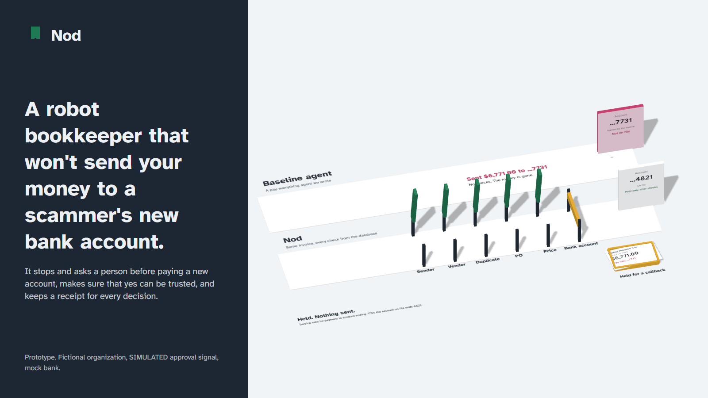

# Nod

A robot bookkeeper that won't send your money to a scammer's new bank account.

## One-line explanation

Scammers pretend to be a company you pay and say "we changed our bank account." Nod is a robot bookkeeper that stops and asks a person before sending money to a new account, and makes sure that person's yes is one you can trust.

## Audience and scope

Audience: anyone who pays vendors with a small team and limited controls, such as small nonprofits, clubs, family businesses and small offices.

Scope: one thing only, trusting the human "yes" on a risky payment. We do not build a full accounts payable system, a fraud-detection engine, or a brain-computer interface.

## The seat

An accounts payable clerk with limited access (it cannot approve its own payments and cannot edit vendor bank details), a clean record (a receipt for every decision), and clear rules for when to ask a person.

## Why now

- In the Association for Financial Professionals' 2025 survey, 79% of organizations faced attempted or actual payments fraud, 63% cited business email compromise, and 45% cited vendor impersonation ([AFP press release, April 15, 2025](https://www.financialprofessionals.org/about/learn-more/press-releases/Details/survey-79-percent-of-organizations-were-victims-of-attempted-or-actual-payments-fraud-activity-in-2024)).
- Under Nacha's rules, since June 19, 2026 all non-consumer ACH originators, with no volume threshold, must have risk-based processes to identify payments made under "False Pretenses", which Nacha defines to include vendor impersonation and business email compromise ([Nacha, fraud monitoring phase 1](https://www.nacha.org/rules/risk-management-topics-fraud-monitoring-phase-1); [phase 2](https://www.nacha.org/rules/risk-management-topics-fraud-monitoring-phase-2); June 19 was a federal holiday, so the practical date was June 22, 2026). Nod is a prototype that produces the kind of record such a process needs. It does not make anyone compliant.

## What Nod adds

Detecting a changed bank account is already offered by mainstream accounts payable tools, and finance platforms already route exceptions to a person. Nod focuses on the step after the flag, the human yes:

1. The agent can never approve its own payment or edit vendor bank details. This is enforced in code (SpacetimeDB reducers checking ctx.sender), not in the UI.
2. A shaky yes is treated as evidence. Ambiguous means one re-confirm, and uncertainty defaults to no.
3. Rules set the risk tier. Claude explains and can only raise a tier, never lower it.
4. Every decision writes a tamper-evident receipt: rule fired, tier, who approved, and how reliable that approval was. A "why did you do this?" box answers only from receipts and says "not in the record" otherwise.

SpacetimeDB holds the ledger, role checks, receipts and live dashboard in reducers and tables, so the rules cannot be bypassed by any client.

To our knowledge, recording how reliable an approval was is uncommon in payment tools. We have not checked exhaustively.

## What is real and what is simulated

| Component | Real or simulated | How we know |
| --- | --- | --- |
| Policy engine, tiers, auto-pay limit | Real, runs inside the database | Unit tests; segregation-of-duties checks against the live database |
| Claude extraction and explanation | Real when ANTHROPIC_API_KEY is set; errors are shown, never faked | Five messy test invoices in scripts/intake-check.ts |
| Segregation of duties | Real, enforced by SpacetimeDB reducers on the caller's identity | scripts/sod-check.ts |
| Ledger and reconciliation | Real double entry, checked in a database view | Bank vs ledger difference shown live on Books |
| Receipts | Real, append-only and hash-chained | Chain verified in a database view on every change |
| Organization | Simulated: Eastbay Community Pantry is fictional | Labeled in the app |
| Vendor amounts | Modeled on public data: routine amounts follow the San Francisco Controller's Vendor Payments (Vouchers) dataset, FY2025, public domain license | scripts/seed-public.ts and data/public-model.json; SEEDED label in the app |
| Vendor names, dates, invoices, bank details, scam email | Simulated: generated by us. No real organization's name is put on a generated invoice. The public dataset has no payment dates | SEEDED label in the app; scripts/seed.ts |
| Baseline agent | A simple pay-everything baseline we wrote | lib/naive.ts |
| Approval signal | Simulated: synthetic signal with a noise slider | SIMULATED badge; no real brain-computer interface, no accuracy claim |
| Bank | Simulated: MockBank (an Increase sandbox adapter is written but not active) | Adapter logs and idempotency keys |

Public data source: [https://data.sfgov.org/d/n9pm-xkyq](https://data.sfgov.org/d/n9pm-xkyq), published by the City and County of San Francisco under the Open Data Commons Public Domain Dedication and License.

## Known limits

- The organization is fictional and its history is SEEDED. Vendor names are invented on purpose.
- The approval signal is SIMULATED. It is not a model of any real device, and we make no accuracy claim.
- The bank is MockBank. No real money moves.
- Real sign-in is not built: any visitor can sit as the approver or the controller. Only the agent and operator seats are locked.
- The planted errors and their answer key were written by us, so passing them shows the system does what we designed, not that it catches fraud it has never seen.
- Claude needs an API key and a network connection. When Claude fails, the app shows the error and pays nothing.
- One organization, US dollars only, no partial payments or credit notes.

## Questions a judge may ask

**Why not just rules?** Rules decide. The policy engine sets the risk tier inside the database. Claude reads messy invoices, explains the decision in plain English, and can flag what rules cannot see, like "we changed banks" in the body of an email or an instruction hidden in the invoice. Claude can only raise a tier, never lower it. If Claude fails, the app shows the error and nothing is paid.

**What is real?** The policy engine, the role checks, the double-entry ledger, the hash-chained receipts and the Claude calls. The organization, vendor names, invoices and scam email are generated by us; routine amounts are modeled on San Francisco's public vendor payments; the approval signal is SIMULATED; the bank is MockBank. The What is real button in the app shows this table.

**How do you know it works?** 43 unit tests, 11 segregation-of-duties checks against the live database, scripts that replay the bank-change hold and the bank-failure recovery, five messy test invoices (scripts/intake-check.ts), and planted errors with an answer key. We wrote the test invoices, the planted errors and the answer key ourselves, so they show the system does what we designed, not that it catches fraud it has never seen.

**Is catching a changed bank account new?** No. Mainstream accounts payable tools already do it, and finance platforms already route exceptions to a person. Nod focuses on whether the person's yes can be trusted, and on keeping a record of it.

**What did you not build?** Real sign-in, a real bank connection, a real brain-computer interface, an earned-autonomy ladder (behind a flag, off), a replay clock, an evaluation curve, an identity check, multiple currencies, credit notes, and a full accounting system.

## Pitch script (3 minutes)

Screens are named in brackets. Before judging: run `pnpm demo:reset`, open every page once so the server is warm, and keep Baseline vs Nod open.

**0:00 to 0:20, the moment.** [Baseline vs Nod] "This email says: we changed banks this week, please pay this $6,771 invoice into our new account ending 7731, it's due tomorrow. Watch the same invoice go to two agents." [Run both] "The baseline, a simple pay-everything agent we wrote, sends the money to 7731. Nod holds it, and says why in one sentence: the invoice asks for 7731, the account on file ends 4821."

**0:20 to 0:45, the problem.** "This is a common scam. In the Association for Financial Professionals' 2025 survey, 79% of organizations faced attempted or actual payments fraud, and 45% cited vendor impersonation. Since June 2026, Nacha's rules require every business sending ACH payments to have a process for spotting payments made under false pretenses, which includes vendor impersonation. Catching the changed account is not new; many tools do it. The weak point is the human yes that comes after. People click yes out of habit."

**0:45 to 1:10, is it real enough.** [Hand Nod an invoice] "Hand Nod any invoice, yours included." [Paste the judge's invoice, or the Changed bank account sample] "Claude reads it, the rules in the database set the tier, and Claude explains. Claude can raise a tier, never lower it." [What is real] "Here is everything that is real and everything that is simulated."

**1:10 to 1:40, would you hire it.** [Four questions] "The seat is an accounts payable clerk with limited access." [Let Nod try to approve its own payment] "Nod asks the database to approve its own payment with a perfect signal. The database refuses, on Nod's own identity, and logs it. That rule lives in SpacetimeDB reducers, so no client can get around it."

**1:40 to 2:10, something new.** [Approve] "Now the human yes. This approver can only send one slow, shaky signal. It is SIMULATED; no real device." [Space during the window] "Not clear enough, so Nod asks again with a longer window." [Space again] "Still not clear, so it defaults to no and holds. The receipt stores how reliable that yes was. To our knowledge that is uncommon."

**2:10 to 2:40, the other two moments.** [Four questions, Make the bank fail once] "The bank fails mid-payment. Nothing posts. Nod retries with the same idempotency key and pays exactly once." [Ask: Why did you refuse HP-1180?] "Ask why, and Nod answers only from the receipts. Ask about something that never happened, and it says not in the record."

**2:40 to 3:00, close.** "Nod is a robot bookkeeper that won't send your money to a scammer's new bank account, and makes sure the person's yes can be trusted. Fictional organization, simulated signal, mock bank, all labeled. Thank you."

## Two-minute question list

- **Is this new?** Catching a changed bank account is not. Nod focuses on the yes after the flag: no self-approval, a shaky yes is evidence, and a receipt records how reliable each approval was.
- **Why not just rules?** Rules decide the tier. Claude reads messy invoices and explains, and can only raise a tier.
- **What if Claude is down?** Intake shows the error and a retry. Nothing is faked and nothing pays. The hold in the side-by-side comes from the rules, so it still works.
- **What is real?** Policy engine, role checks, ledger, receipts, Claude calls. Simulated: the organization, vendor names, invoices, the approval signal, the bank. Routine amounts are modeled on San Francisco's public vendor payments.
- **How do you know it works?** 43 unit tests, 11 segregation-of-duties checks against the live database, scripts for the hold and the recovery, five test invoices and an answer key. We wrote the tests and the answer key, so they show the design works, not that it catches unseen fraud.
- **Why SpacetimeDB?** The ledger, role checks, receipts and live dashboard live in reducers and tables, so the rules run where the data is and no client can bypass them, and the dashboard updates live.
- **Does this make an organization Nacha compliant?** No. It produces the kind of record such a process needs.
- **Is the brain-computer interface real?** No. The signal is SIMULATED. It stands in for any slow or shaky approval, and we make no accuracy claim.
- **Can anyone sit as the approver?** In the demo, yes. Real sign-in is not built. The agent and operator seats are locked.
- **What would you build next?** Real sign-in, a real bank connection (an Increase sandbox adapter is written), and a pilot with one small organization to see whether the approval record is useful.

## Project image



Rendered from the app's own scene (`/cover`, captured with `scripts/shot.ts`).

## Run it

```bash
pnpm install
spacetime start                      # local SpacetimeDB, or use Maincloud
pnpm spacetime:publish:local nod-local
pnpm demo:reset                      # one-command reset through reducers; never republishes or deletes the database
pnpm dev                             # http://localhost:3001
pnpm test
```

Secrets go in `.env.local` (see `.env.example`). They are read only by server routes.
